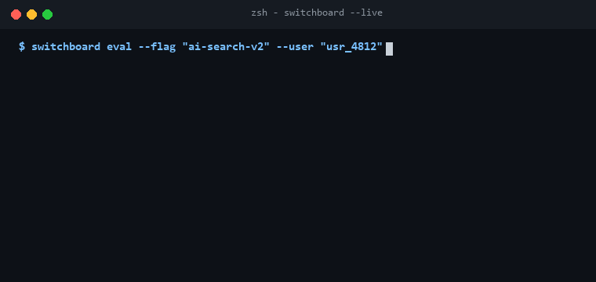

<p align="center">
  
</p>

<p align="center">
  <a href="https://github.com/Gaurav28-tech/switchboard/actions"></a>
  <a href="LICENSE"></a>
  
  
</p>

<p align="center">
  <b>Switchboard</b> is a deterministic feature flagging and progressive canary rollout engine engineered for high-availability SaaS and distributed systems. It features stable user-bucketing algorithms, rule-based audience targeting, instant kill-switches, and local evaluation with sub-millisecond execution.
</p>

---

## ⚡ Live Terminal Preview

<p align="center">
  
</p>

---

## 🚀 Key Capabilities

- **Deterministic Hash Bucketing**: Employs cryptographic SHA-256 bucketing ensuring a user consistently stays in the same rollout bucket (0–100%) across all servers without session affinity.
- **Audience Targeting Rules**: Match user attributes by equality, set inclusion (`in`), regex patterns, or numerical ranges.
- **Instant Kill-Switches**: Master enable/disable flags to neutralize faulty features in production instantly.
- **Local In-Memory Evaluation**: Flags evaluate purely in-process in microseconds without blocking network calls to remote flag servers.
- **Zero Heavy Dependencies**: Pure standard library Python with full type annotations.

---

## 🏗️ Architecture

<p align="center">
  
</p>

---

## 📦 Quickstart

### Installation

```bash
git clone https://github.com/Gaurav28-tech/switchboard.git
cd switchboard
```

### Basic Usage

```python
from pilot.client import FeaturePilot
from pilot.models import FeatureFlag, TargetingRule

client = FeaturePilot()

# Define 20% canary rollout flag for beta search
flag = FeatureFlag(
    key="ai-search-v2",
    description="Next-gen semantic vector search",
    enabled=True,
    rollout_percentage=20, # 20% of all users
    rules=[
        TargetingRule(attribute="tier", operator="equals", value="enterprise") # Always on for enterprise
    ]
)
client.register_flag(flag)

# Evaluate flag for a user
is_enabled = client.is_enabled(
    flag_key="ai-search-v2",
    user_id="usr_9812",
    attributes={"tier": "enterprise"}
)
print(f"Feature Enabled: {is_enabled}")
```

### Running Test Suite

```bash
python -m unittest discover -s tests -p "test_*.py"
```

---

## 📄 License

Distributed under the [MIT License](LICENSE).
